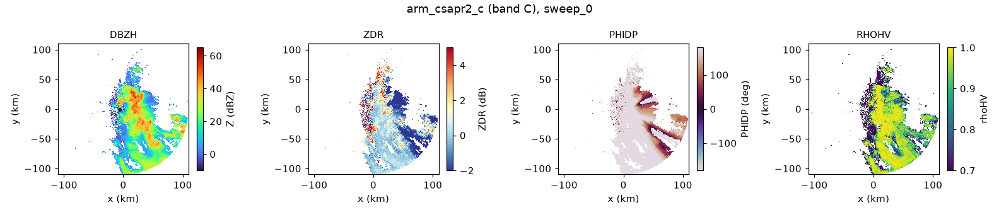
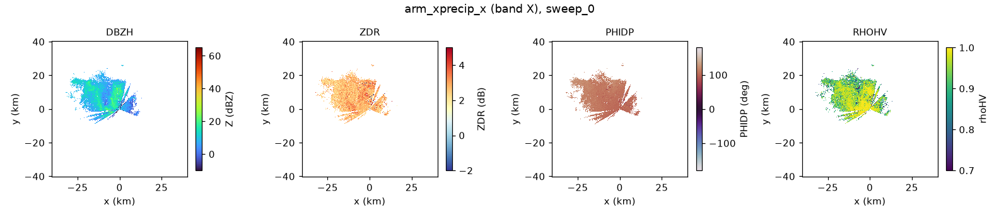
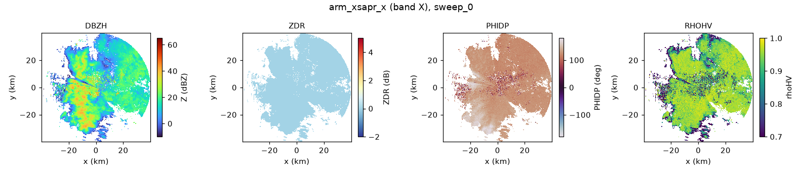
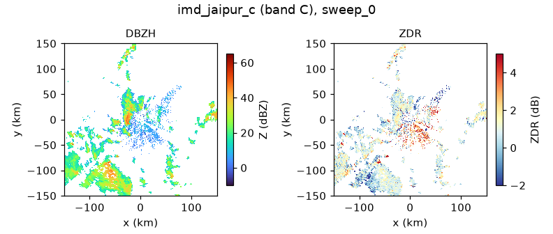
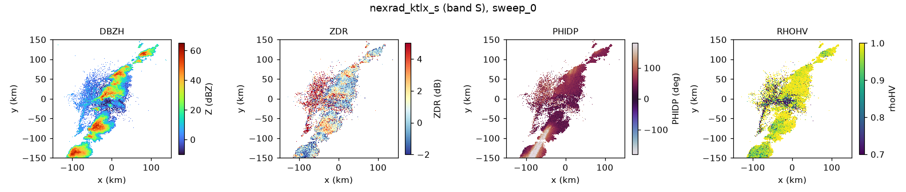

# radarwow-core

**radar-wow: Core.** Shared I/O (NEXRAD, ODIM, CfRadial, IRIS, IMD FSL), canonical moment names, band configs (S/C/X), algorithm interface, free sample data, health checks.

Part of [radar-wow](https://github.com/manmeet3591/radar-wow), a set of repos that together build a radar QPE system that works for S, C and X band radars.
Every algorithm is one class implementing one paper, with the same interface: it takes an xradar sweep or volume with canonical moment names, declares the bands and moments it needs, and records provenance.

## Sub-components

| sub-component | algorithm | source | DOI | status |
|---|---|---|---|---|
| I/O + names | `open_volume`, `standardize` | xradar DataTree; CF metadata before variable names |  | implemented + notebook |
| band configs | `load_band('S'|'C'|'X')` | every parameter cites its source |  | implemented + notebook |
| free data | `load_sample`, `nexrad_aws` | open-radar-data + NEXRAD on AWS |  | implemented + notebook |
| health checks | `diagnose` | measures each radar's problems, names the stage that fixes them |  | implemented + notebook |

## Install

```bash
pip install git+https://github.com/manmeet3591/radarwow-core
```

## Notebooks (free data, S / C / X band)

- [`notebooks/00_free_data_and_health_checks.ipynb`](notebooks/00_free_data_and_health_checks.ipynb): open in Colab via `https://colab.research.google.com/github/manmeet3591/radarwow-core/blob/main/notebooks/00_free_data_and_health_checks.ipynb`

## Results







## Status legend

*implemented + notebook*: code, tests, executed notebook. *planned*: interface fixed, code to write. *stub*: class exists, raises `NotImplementedError`. *to review*: paper to read before deciding.

## License

MIT. Data used in the notebooks comes from public archives (NEXRAD on AWS, ARM, IMD via open-radar-data) under their own terms.
